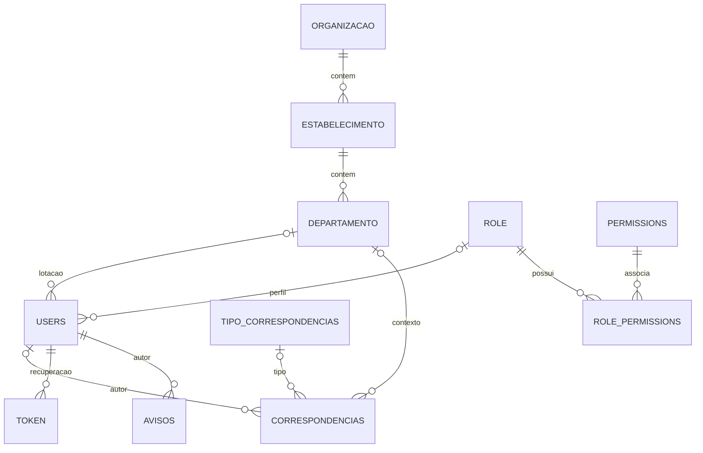
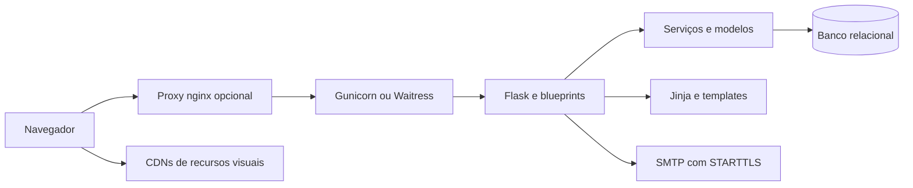

# Expediente — As Is

**Data:** 11/10/2026. **Base:** commit `a5e1caef540ff69cabf1ccf93e682d152eca6672`, branch de trabalho `chore/preparacao-as-is`. **Escopo:** fotografia do código atual, sem definição de To Be e sem alteração da aplicação.

## 1. O que o sistema é hoje

O Expediente é uma aplicação web interna para **registrar e consultar números de correspondências oficiais**. O usuário informa tipo, assunto e visibilidade; o sistema gera o número e associa o registro ao autor e ao departamento. A organização, seus estabelecimentos e departamentos dão contexto à numeração e à consulta.

Sua origem é a Secretaria Municipal de Saúde de Itaberaí, com a intenção declarada de substituir o controle manual de correspondências por um cadastro centralizado (`README.md:3`). Embora o repositório agora se chame Expediente, o código ainda contém nomes como Gestão Saúde, SIS-Health Plus e referências à Secretaria de Saúde. Esses nomes são parte do estado atual, não requisitos de uma versão futura (`README.md:1`, `app/utils/comunications/email.py:58`, `docker-compose.yml:4`).

**Distinção essencial:** o registro chamado “correspondência” contém metadados e número. Não contém o conteúdo integral de um memorando/ofício, arquivo anexado, destinatário, histórico de tramitação, confirmação de recebimento ou assinatura. O modelo central confirma essa delimitação (`app/models/correspondencias.py:4`). A interface chama a listagem de “Enviados”, mas não há envio de correspondência oficial nessa operação (`app/blueprints/mail.py:100`).

O núcleo entrega cadastro, numeração e consulta. Há funcionalidades de apoio implementadas: contas de usuário, perfis/permissões, estrutura organizacional e mural de avisos. Existem modelos de contratos e orçamento que ampliam a base de código, mas não constituem módulos funcionais expostos pelos blueprints registrados.

## 2. Como ler esta análise

- **Fato estático:** comportamento diretamente identificável em modelos, rotas, serviços e templates. Uma rota existir não comprova que todas as suas combinações funcionem em execução.
- **Inferência:** interpretação do propósito ou consequência provável do código; identificada quando relevante.
- **Não verificado:** depende de banco real, SMTP, navegador, implantação, carga ou decisão do negócio.

Foi feita leitura dos fluxos principais, inventário de arquivos e extração estrutural com Graphify, além de verificação sintática de 78 arquivos Python. Os artefatos intermediários estão em `.agents/work/graphify/`. Não foi executada a aplicação: o Python local consultado não tem Flask instalado; não foram criados banco, contas ou serviços. A extração estrutural produziu 416 nós e 822 arestas e auxiliou o inventário; não foi realizado o pipeline completo de extração semântica, clustering ou visualização. O detector omitiu `.env.example` e `app/templates/pages/user/password.html` como potencialmente sensíveis; o fluxo de senha foi conferido pelo código das rotas. Um arquivo de configuração JSON não produziu nós. As conclusões abaixo se apoiam na leitura do código, não apenas no grafo.

## 3. Usuários, perfis e alcance

| Ator identificado no código | Uso atual |
|---|---|
| Usuário autenticado comum | Cria correspondências associadas à sua lotação e consulta os próprios registros; vê o mural e altera seu perfil/senha. |
| Responsável por departamento | A listagem inclui correspondências do departamento, com seleção de colaboradores. |
| Responsável por estabelecimento | A listagem permite consultar o estabelecimento e selecionar departamentos. |
| Responsável por organização | A listagem permite consultar a organização e selecionar estabelecimentos. |
| Usuário com `acesso restrito` | Acessa gestão de usuários e estrutura organizacional, além de APIs auxiliares. |
| Usuário com `gerenciamento master` | Gerencia perfis e permissões nas rotas que exigem essa permissão. |

Evidências: `app/blueprints/mail.py:110`, `app/blueprints/user.py:102`, `app/blueprints/manager_org.py:17`, `app/blueprints/admin.py:14`.

Responsabilidade organizacional e papel de acesso são conceitos distintos. A responsabilidade é uma referência a usuário na organização, estabelecimento ou departamento; as permissões são associadas ao perfil do usuário por uma tabela intermediária (`app/models/organizacao.py:12`, `app/models/estabelecimento.py:12`, `app/models/departamento.py:14`, `app/models/role_permissions.py:96`). Se a mesma pessoa for responsável em mais de um nível, a listagem escolhe primeiro organização, depois estabelecimento e depois departamento.

O bootstrap cria um perfil Master com todas as permissões cadastradas. Novos usuários recebem `role = 1` diretamente: na base criada pelo bootstrap, esse ID corresponde ao perfil Master. Portanto, o código atual não estabelece um perfil comum separado como padrão de novos cadastros (`app/utils/bootstrap.py:106`, `app/blueprints/user.py:139`). A classificação “usuário comum” acima descreve o caminho de consulta de quem não é responsável, não um papel pré-configurado com isolamento garantido.

## 4. Funcionalidades entregues e limites

| Área | Implementação identificada | Limite atual |
|---|---|---|
| Correspondência | Cadastro de tipo, assunto e visibilidade; geração de número e apresentação da confirmação. | Apenas registro de metadados; sem anexos ou geração de documento. |
| Consulta | Filtros por número/ano, assunto, intervalo de datas, tipo, visibilidade e hierarquia; paginação de 20 itens e ordenação por ID. | O alcance depende da lógica das rotas e dos parâmetros; ver limitações de autorização. |
| Edição | Altera assunto e visibilidade. | Sem histórico de alterações; não altera número/tipo/data na operação identificada. |
| Tipos | Tabela de tipos e opções na criação. Bootstrap inclui Memorando, Ofício, Despacho e Portaria. | Não foi identificada interface dedicada para administrar tipos. |
| Usuários | Cadastro, consulta filtrada, edição, bloqueio/desbloqueio, ativação/desativação, troca e redefinição de senha, atribuição de perfil. | Existem divergências entre intenção e implementação nos controles de senha e ativação. |
| Organização | Cadastro/edição de organizações e estabelecimentos; cadastro e manutenção de departamentos; definição de responsáveis; seleção hierárquica. | Há dois caminhos de manutenção de departamentos, com controles diferentes. |
| Perfis/permissões | Cadastro/edição/exclusão de perfis e permissões; associação de permissões e atribuição de perfil ao usuário. | Uso de nomes textuais de permissões, incluindo uma grafia divergente em rota. |
| Avisos | Mural cronológico; criar, editar e apagar avisos; descrição convertida de Markdown para HTML. | Controle nas rotas exige login, mas não exige a permissão de gestão de avisos. |
| E-mail | Mensagem de boas-vindas ao cadastrar usuário e link de recuperação de senha via SMTP/STARTTLS. | Não há chamada de e-mail no cadastro de correspondência; entrega real não verificada. |

Evidências centrais: `app/blueprints/mail.py:18`, `app/services/correspondencia_service.py:145`, `app/blueprints/user.py:181`, `app/blueprints/admin.py:72`, `app/blueprints/manager_org.py:51`, `app/blueprints/views.py:114`, `app/utils/comunications/email.py:20`.

### README versus implementação

A geração automática de números, categorização e registro/consulta têm correspondência no código. A declaração de “notificações automáticas” sobre novas correspondências ou ações pendentes não foi confirmada: o fluxo de correspondência apenas persiste o registro e redireciona para a confirmação. E-mails existentes tratam de contas. “Arquivar” no README não corresponde a estado de arquivamento no modelo. Benefícios declarados de segurança, privacidade e rastreamento são intenções, não garantias demonstradas por esta análise (`README.md:11`, `README.md:23`, `app/blueprints/mail.py:34`, `app/models/correspondencias.py:4`).

## 5. Fluxos e regras de negócio atuais

### 5.1 Acesso

O usuário informa username e senha. A autenticação consulta a conta, impede login de conta bloqueada e verifica o hash com Werkzeug. Após sucesso, zera tentativas e cria a sessão. Após dez falhas para um usuário existente, bloqueia a conta; desbloqueio administrativo zera tentativas. Não há autocadastro público identificado (`app/blueprints/auth.py:23`, `app/services/usuario_service.py:49`, `app/models/users.py:107`).

### 5.2 Criar e numerar correspondência

1. Usuário autenticado abre `/mail/new` e escolhe tipo, assunto e visibilidade.
2. A rota obtém autor, departamento e organização a partir do usuário logado.
3. O serviço busca o último registro, ordenado pelo ID, do mesmo tipo e organização. O contexto de organização é obtido por correspondência → departamento → estabelecimento → organização.
4. Se não houver registro, retorna 1. Se o ano do último registro difere do ano atual, retorna 1. Caso contrário, incrementa o número desse registro.
5. Salva data atual, ano, número e texto `numero/ano`, junto com assunto, autor, departamento e visibilidade.
6. Redireciona para a tela de confirmação com o número gerado.

Evidências: `app/blueprints/mail.py:18`, `app/services/correspondencia_service.py:14`, `app/services/correspondencia_service.py:51`.

A sequência é, portanto, **por organização e tipo, reiniciada por ano conforme o último registro**. Não é por usuário ou departamento. Não se usa uma tabela exclusiva de sequências. A organização não é gravada diretamente na correspondência: sua identificação depende da estrutura organizacional vinculada ao departamento. **Inferência:** realocar um departamento para outro estabelecimento/organização pode alterar o contexto histórico usado por consultas e numeração.

A aplicação supõe usuário lotado em departamento com estabelecimento e organização válidos, embora o modelo permita usuário sem departamento (`app/models/users.py:16`). Sem essa cadeia, a criação pode falhar e mostrar a mensagem genérica de erro.

### 5.3 Consultar e editar

O alcance inicial da consulta é escolhido conforme responsabilidade organizacional. Depois são aplicados filtros. O serviço utiliza `if/elif` para escolher um único escopo: usuário, departamento, estabelecimento ou organização, nessa ordem. Filtros de número e assunto são buscas parciais; datas delimitam o campo `data`; a ordenação é por ID. Sem seleção de visibilidade, a rota considera todas selecionadas (`app/blueprints/mail.py:73`, `app/services/correspondencia_service.py:185`).

A edição aceita ID, assunto e visibilidade e atualiza o registro. O template sinaliza visualmente quando o usuário não é autor, mas a rota não repete uma checagem de autoria (`app/templates/components/macros/card_mail.html:7`, `app/blueprints/mail.py:173`).

### 5.4 Recuperar senha

A solicitação busca usuário por e-mail, gera token aleatório, persiste o token e envia link externo. A redefinição procura o token, confere o username associado e atualiza o hash da senha (`app/blueprints/views.py:37`, `app/utils/comunications/email.py:103`). O campo de expiração prevê 30 minutos, mas a validação apenas procura o token; não compara a expiração nem o consome após uso (`app/models/token.py:15`, `app/models/token.py:30`).

## 6. Modelo de dados

| Entidade | Conteúdo e relações principais |
|---|---|
| `correspondencias` | ID, tipo, número, ano, número/ano, assunto, autor, data, visibilidade (`publica`, `privada`, `sigilosa`) e departamento. FKs para tipo, usuário e departamento. |
| `tipo_correspondencias` | Identificação, nome do tipo e descrição. |
| `users` | Nome, CPF opcional, username único, hash de senha, e-mail único opcional, departamento, perfil, tentativas, bloqueio, ativo e criação. |
| `organizacao` | Nome, sigla, responsável, ativo e datas de criação/atualização. |
| `estabelecimento` | Nome, organização obrigatória, responsável, ativo e datas. |
| `departamento` | Nome, estabelecimento obrigatório, responsável, ativo e datas. |
| `role`, `permissions`, `role_permissions` | Perfil, permissão e associação entre ambos. Usuário possui um perfil. |
| `avisos` | Título, descrição textual, autor e datas de criação/atualização. |
| `Token` | Usuário, token único e data de expiração. |

Evidências: `app/models/correspondencias.py:4`, `app/models/users.py:11`, `app/models/role_permissions.py:4`, `app/models/avisos.py:5`, `app/models/token.py:9`.

Os modelos adicionais incluem `Item`; contratos, solicitações, fornecedores, lotações e tipos de contrato; fichas, fontes, aplicações programadas, elementos de despesa, contas e rubricas orçamentárias; e edital. São importados pelo bootstrap e podem resultar em tabelas na criação da base. Há serviços de parte do orçamento, mas não blueprints registrados para operar esses módulos (`app/utils/bootstrap.py:39`, `app/blueprints/views.py:25`). **Conclusão estática:** representam estrutura de expansão existente no código, não entrega funcional confirmada. Permissões “regulacao” e “pesquisa” também são semeadas, sem módulo correspondente registrado (`app/utils/bootstrap.py:15`).

## 7. Arquitetura e tecnologia

A arquitetura é um **monólito web Flask com HTML renderizado no servidor**, banco relacional e integração SMTP. Não há SPA, aplicação móvel, fila de tarefas ou API externa geral identificada.

- `app/app.py:20` cria o Flask, exige `DATABASE_URL` e `SECRET_KEY`, registra filtros/contexto, configura cookies e ProxyFix; `create_app()` carrega extensões e bootstrap.
- `settings.toml:2` define carregamento de banco, autenticação e views via Dynaconf.
- `app/blueprints/views.py:25` registra seis blueprints: correspondências, autenticação, usuários, departamentos, administração e organização; também contém mural e recuperação de senha.
- `app/services/` concentra parte das regras e consultas; outras persistências ocorrem diretamente nas rotas e nos modelos. A separação em camadas existe, mas não é uniforme.
- SQLAlchemy/Flask-SQLAlchemy persistem entidades; Flask-Login controla sessão; Flask-WTF/WTForms descrevem formulários; Jinja renderiza páginas.
- Bulma, Font Awesome e HTMX são carregados por CDN (`app/templates/base.html:5`). Há JS e CSS locais, incluindo seleções organizacionais dinâmicas.

`requirements.txt` fixa versões: Flask 3.1.3, SQLAlchemy 2.0.54, Flask-SQLAlchemy 3.1.1, Flask-Login 0.6.3, Dynaconf 3.3.5, PyMySQL 1.2.0, Gunicorn 26.2.0 e Waitress 3.0.2, entre outras. Flask-Mail e flask-talisman estão declarados, mas não aparecem nas extensões carregadas; o envio de e-mail usa `smtplib`. Dependência declarada não comprova utilização ou proteção ativa.

## 8. Configuração, execução e deploy

| Caminho | Situação no repositório |
|---|---|
| Desenvolvimento | README orienta instalar requirements, configurar ambiente e executar `flask run`; não explicita nesse comando o módulo/factory. |
| Container | Dockerfile usa Python 3.14 e inicia `gunicorn app.app:create_app()` na porta 5000. `.dockerignore` exclui `.env`, Git, ambientes virtuais e `.agents`. |
| Docker Compose | Aplicação + MariaDB 10, volume persistente, Adminer e Portainer. A aplicação publica 5000; interfaces auxiliares usam loopback. `depends_on` existe, sem healthcheck de prontidão do banco. |
| Windows Server | `serve.py` executa Waitress em loopback por padrão, porta 5000 e oito threads; scripts/documentação usam NSSM e nginx com TLS. |
| CI/publicação | Workflow em tags instala dependências e publica imagem no Docker Hub; workflow manual publica no GHCR. Não executam suíte de testes. |

Evidências: `README.md:99`, `Dockerfile:2`, `docker-compose.yml:1`, `serve.py:15`, `deploy/windows/README.md:3`, `.github/workflows/main.yml:3`, `.github/workflows/cm-compose.yml:3`.

Variáveis obrigatórias na factory: `DATABASE_URL` e `SECRET_KEY`. Cookies de sessão têm Secure habilitado por padrão, HttpOnly e SameSite Lax; debug é desativado. HTTP direto requer configuração compatível do cookie. SMTP depende de `EMAIL_USER`, `EMAIL_PASSWORD`, `EMAIL_SMTP_SERVER` e `EMAIL_SMTP_PORT` (`app/app.py:24`, `app/utils/comunications/email.py:22`).

O bootstrap, habilitado por padrão por `SEED_ON_EMPTY`, importa modelos e executa `db.create_all()`. Se já houver qualquer usuário, não semeia dados. Em base vazia cria administrador, perfil, permissões, hierarquia exemplo, tipos e aviso. A credencial inicial é fixa no código; seus valores não são reproduzidos neste documento. Falhas são registradas como warning e não necessariamente impedem a factory de retornar (`app/utils/bootstrap.py:153`). Não foi identificado sistema de migrações de schema; `create_all()` não representa versionamento de alterações em tabelas existentes.

Ainda há nomes antigos em containers/banco e imagens de publicação: `gestao_saude`, `sis-healthplus` e `conecta_mais`. README informa Gunicorn 21.2.0, enquanto requirements fixa 26.2.0. Os links de contribuição/licença e o clone exemplificado precisam ser tratados como documentação declarativa; não foram encontrados `CONTRIBUTING.md` e `LICENSE` no inventário.

## 9. Qualidade e limitações observadas

Esta seção registra condições atuais e consequências; não define soluções ou backlog da versão 2.

| Constatação estática | Implicação atual | Evidência |
|---|---|---|
| Consulta do próximo número e inserção são operações separadas; modelo não define unicidade para organização/tipo/ano/número. | Duas requisições concorrentes podem gerar o mesmo número. Ocorrência real não testada. | `app/services/correspondencia_service.py:14`, `app/models/correspondencias.py:4` |
| Visibilidade é armazenada e filtrada, sem regras especiais de autorização para privada/sigilosa. | Rótulos não equivalem a isolamento de acesso. | `app/services/correspondencia_service.py:206`, `app/blueprints/mail.py:92` |
| Serviço escolhe apenas um escopo, priorizando parâmetros de usuário/departamento/estabelecimento antes da organização. | Para responsáveis, parâmetros recebidos não são cumulativamente limitados ao escopo organizacional; possível consulta fora do alcance pretendido. | `app/services/correspondencia_service.py:185`, `app/blueprints/mail.py:75` |
| Confirmação consulta correspondência por ID e edição aceita ID sem checar autoria/escopo. | Login não garante autorização sobre o registro específico. | `app/blueprints/mail.py:64`, `app/blueprints/mail.py:173` |
| Rotas de avisos não exigem `gestao de avisos`; exclusão de departamento não exige login. | Permissões do menu não bastam para proteger operações diretas. | `app/blueprints/views.py:132`, `app/blueprints/departmento.py:71` |
| Há operações mutáveis por GET, como exclusões e bloqueios. | A semântica das rotas e proteção de operações administrativas são inconsistentes. | `app/blueprints/user.py:312`, `app/blueprints/admin.py:59` |
| Formulários têm validadores, mas fluxos principais usam `request.method` sem `validate_on_submit`; não há CSRFProtect global registrado. | Regras declaradas nos forms e campos CSRF nos templates não demonstram validação efetiva no servidor. | `app/forms/mail_form.py:6`, `app/blueprints/mail.py:26`, `settings.toml:2` |
| Login não verifica `usuario.ativo`. | Desativação administrativa não impede explicitamente login pelo fluxo identificado. | `app/blueprints/auth.py:26`, `app/services/usuario_service.py:139` |
| Troca de senha lê senha atual, mas compara o hash com a nova senha. | Confirmação da senha atual não é aplicada como sugere a interface. | `app/blueprints/user.py:34` |
| Token de recuperação não confere expiração nem é invalidado após alteração. | Prazo configurado e uso único não são efetivamente garantidos. | `app/models/token.py:30`, `app/blueprints/views.py:63` |
| Boas-vindas transmite a senha informada em texto no e-mail; há administrador inicial com credencial fixa. | Gestão de credenciais tem limitações específicas verificáveis. Valores não reproduzidos. | `app/utils/comunications/email.py:72`, `app/utils/bootstrap.py:11` |
| Import de `or_` vem de `operator`, não SQLAlchemy. | Combinação de múltiplos filtros de visibilidade usa operador Python sobre expressões SQL; comportamento precisa de validação funcional. | `app/services/correspondencia_service.py:1`, `app/services/correspondencia_service.py:216` |
| Permissão `gerencimento master` difere de `gerenciamento master`. | A exclusão de permissão pode ser negada para o perfil semeado. | `app/blueprints/admin.py:173`, `app/utils/bootstrap.py:16` |
| Caminho antigo de criação de departamento só define nome/ativo, mas estabelecimento é obrigatório. | Cadastro por esse caminho pode falhar no banco; o caminho organizacional informa estabelecimento. | `app/models/departamento.py:25`, `app/blueprints/departmento.py:40`, `app/blueprints/manager_org.py:199` |
| Avisos convertem Markdown e renderizam com `safe`, sem sanitização explícita identificada. | HTML fornecido no aviso pode ser renderizado; explorar a consequência exigiria verificação controlada. | `app/blueprints/views.py:110`, `app/templates/pages/index.html:27` |
| Commits/rollbacks e tratamento de erros variam entre serviços/modelos/rotas. | Diagnóstico e recuperação após falhas de persistência não têm padrão uniforme. | `app/services/correspondencia_service.py:66`, `app/models/users.py:59` |

Não foram encontrados testes automatizados no inventário, configuração de lint/type-check ou migrações. O workflow instala pytest, mas não o executa. A verificação sintática foi aprovada para os 78 arquivos Python consultados; isso não certifica imports, templates, integridade do banco ou comportamento HTTP.

Também não foram identificados trilha de auditoria de correspondências, estratégia documentada de backup/restore, métricas, monitoramento ou teste de carga. Logs e mensagens de erro existem, mas não comprovaram observabilidade operacional. Nenhuma avaliação de vulnerabilidades de dependências foi realizada.

## 10. Pontos que permanecem em aberto

- Validar com o usuário os usos reais: quem gera números, quem consulta os registros e quais regras de acesso eram efetivamente esperadas para as três visibilidades.
- Confirmar se há base histórica a preservar, ainda que o usuário informe que o sistema não está em produção.
- Executar, em ambiente isolado, os fluxos web e as combinações de filtros; testar numeração concorrente e mudança de ano.
- Conferir schema e dados reais, se existirem; o banco pode divergir dos modelos presentes no commit.
- Validar entrega SMTP, caminhos de recuperação de senha e configuração de implantação; existência de script não comprova deploy ativo.

Esses itens delimitam o grau de certeza do As Is. Não são decisões do To Be. **Síntese do estado atual:** uma ferramenta web de registro e numeração de correspondências, com administração organizacional e de contas, mural e e-mails de conta; a gestão do documento oficial em si não está implementada no core identificado.
